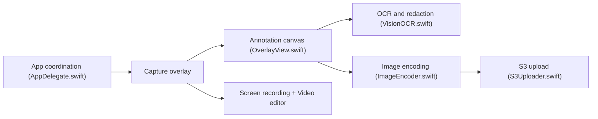

# sw33tLie/macshot

> Native macOS screenshot and screen recording tool, with annotation, OCR and upload.

## The problem
Native macOS captures lack annotation, scrolling, OCR, data masking and one-gesture upload.

## What it actually does
Global shortcut, area selection, annotation (arrows, text, blur/redaction with sensitive data detection), scrolling capture stitched with Apple Vision, MP4/GIF recording with a video editor. OCR and translation, editable history, "beautify". Upload to Google Drive, imgbb or S3-compatible storage. Written in Swift/AppKit.

## How it is wired


## Trying it
```bash
brew install --cask macshot
# puis Cmd+Shift+X pour capturer
```

## Cost and gotchas
Free, no donations accepted. Requires the "Screen Recording" permission. macOS 12.3 minimum. Uploads send your images to a third-party service of your choice. 154 open issues.

## What it is not
Not cross-platform, and GPL-3.0: personal use without constraint, but not reusable in proprietary code. The "richest" claim is the author's.

## Alternatives
No alternative named in the README.

## For you
Ignore for your profile: mainstream macOS utility unrelated to data or AI, only useful if you are on a Mac and take many screenshots.
