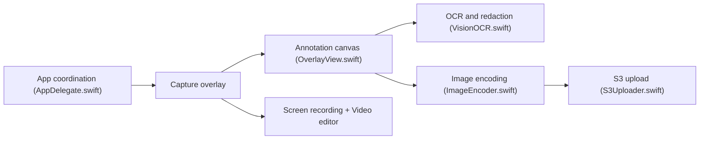

# sw33tLie/macshot

> Outil de capture d'écran et d'enregistrement natif macOS, avec annotation, OCR et upload.

## Le problème
Les captures macOS natives manquent d'annotation, de défilement, d'OCR, de masquage de données et d'upload en un geste.

## Ce que ça fait vraiment
Raccourci global, sélection de zone, annotation (flèches, texte, flou/censure avec détection de données sensibles), capture défilante assemblée avec Apple Vision, enregistrement MP4/GIF avec éditeur vidéo. OCR et traduction, historique éditable, « beautify ». Upload vers Google Drive, imgbb ou stockage compatible S3. Écrit en Swift/AppKit.

## Comment c'est branché


## Essayer
```bash
brew install --cask macshot
# puis Cmd+Shift+X pour capturer
```

## Coût et pièges
Gratuit, sans don accepté. Demande la permission « Enregistrement de l'écran ». macOS 12.3 minimum. Les uploads envoient tes images à un service tiers que tu choisis. 154 issues ouvertes.

## Ce que ce n'est pas
Pas multiplateforme, et GPL-3.0 : usage personnel sans contrainte, mais pas réutilisable dans du code propriétaire. L'affirmation « la plus riche » est celle de l'auteur.

## Alternatives
Aucune alternative nommée dans le README.

## Pour toi
À ignorer pour ton profil : utilitaire macOS grand public sans lien avec la donnée ou l'IA, utile seulement si tu es sur Mac et captures beaucoup d'écrans.

