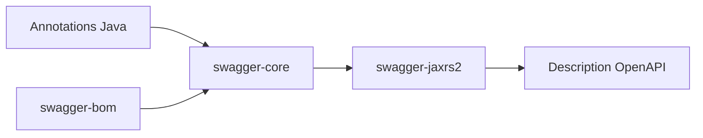

# swagger-api/swagger-core

> Java implementation of the OpenAPI specification, for documenting JAX-RS APIs.

## The problem
Documenting a Java API by hand quickly drifts from the actual code.

## What it actually does
The library provides annotations, models and JAX-RS2 integration in two families of artifacts, `javax` and `jakarta`. It handles OpenAPI 3.0 and 3.1; the 1.5 branch covers OpenAPI 2.0. A Maven BOM manages artifact versions.

## How it is wired
Simplified diagram based on the sheet, no diagram provided.


## Trying it
```bash
mvn -N
mvn install
```

## Cost and gotchas
Free. Java 11 and Maven 3.0.4 or later required. Choose between `javax` and `-jakarta` artifacts.

## What it is not
Not a Swagger UI generator nor a client: it is the Java core. Maven and Gradle plugins are excluded from the BOM.

## Alternatives
No alternative named in the README.

## For you
Ignore: Java library for documenting APIs, outside your data / AI stack.
