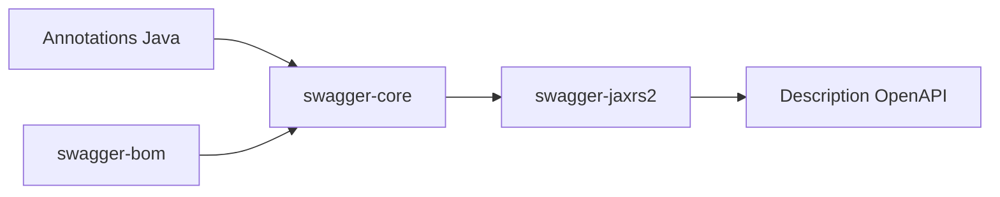

# swagger-api/swagger-core

> Implémentation Java de la spécification OpenAPI, pour documenter des API JAX-RS.

## Le problème
Documenter une API Java à la main dérive vite du code réel.

## Ce que ça fait vraiment
La bibliothèque fournit annotations, modèles et intégration JAX-RS2 en deux familles d'artefacts, `javax` et `jakarta`. Elle gère OpenAPI 3.0 et 3.1 ; la branche 1.5 couvre OpenAPI 2.0. Un BOM Maven gère les versions des artefacts.

## Comment c'est branché
Schéma simplifié d'après la fiche, sans diagramme fourni.


## Essayer
```bash
mvn -N
mvn install
```

## Coût et pièges
Gratuit. Java 11 et Maven 3.0.4 ou plus requis. Choisir entre artefacts `javax` et `-jakarta`.

## Ce que ce n'est pas
Ce n'est pas un générateur d'interface Swagger UI ni un client : c'est le cœur Java. Plugins Maven et Gradle exclus du BOM.

## Alternatives
Aucune alternative nommée dans le README.

## Pour toi
À ignorer : bibliothèque Java pour documenter des API, hors de ta pile data / IA.

