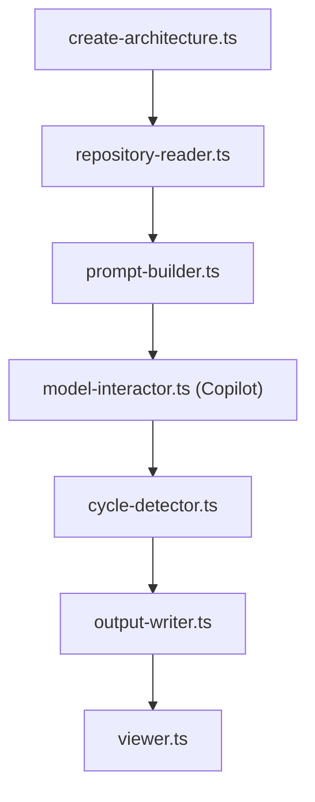

# swark-io/swark

> A VS Code extension that draws a Mermaid architecture diagram from a code folder, via Copilot.

## The problem
Understanding an unfamiliar or inherited repository takes time, and up-to-date diagrams are rare.

## What it actually does
You pick a folder; the extension reads the files within the model's token limit, builds a prompt and sends it to GitHub Copilot through the VS Code models API. It repairs Mermaid cycles, writes a diagram file and a log in `swark-output`, then opens the preview. The code is shared only with Copilot.

## How it is wired


## Trying it
```bash
# Dans VS Code : Command Palette > « Swark: Create Architecture Diagram »
# Raccourci : cmd+shift+r (Mac) ou ctrl+shift+r (Windows)
```

## Cost and gotchas
GitHub Copilot is required (a free tier exists). The last push dates from March 2025. Telemetry is sent to Azure Application Insights, and can be disabled with `"telemetry.telemetryLevel": "off"`. AGPL-3.0 license.

## What it is not
Not a deterministic analyzer: the diagram comes from the LLM and can be wrong. The number of files read is limited by the context window, so a large repository is only seen in pieces.

## Alternatives
- No alternative named in the README.

## For you
Worth watching: handy for mapping an unfamiliar repository, but the inactivity since 2025, the dependence on Copilot and the AGPL weigh against it.
