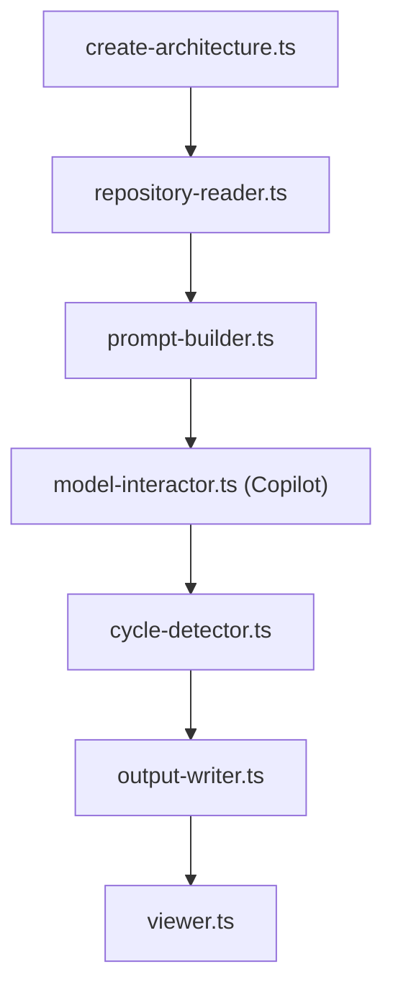

# swark-io/swark

> Extension VS Code qui dessine un diagramme d'architecture en Mermaid à partir d'un dossier de code, via Copilot.

## Le problème
Comprendre un dépôt inconnu ou hérité prend du temps, et les diagrammes à jour sont rares.

## Ce que ça fait vraiment
Tu choisis un dossier ; l'extension lit les fichiers dans la limite de jetons du modèle, construit un prompt et l'envoie à GitHub Copilot par l'API de modèles de VS Code. Elle répare les cycles Mermaid, écrit un fichier de diagramme et un journal dans `swark-output`, puis ouvre l'aperçu. Le code n'est partagé qu'avec Copilot.

## Comment c'est branché


## Essayer
```bash
# Dans VS Code : Command Palette > « Swark: Create Architecture Diagram »
# Raccourci : cmd+shift+r (Mac) ou ctrl+shift+r (Windows)
```

## Coût et pièges
Il faut GitHub Copilot (une offre gratuite existe). Le dernier push date de mars 2025. Télémétrie envoyée à Azure Application Insights, désactivable avec `"telemetry.telemetryLevel": "off"`. Licence AGPL-3.0.

## Ce que ce n'est pas
Pas un analyseur déterministe : le diagramme vient du LLM et peut se tromper. Le nombre de fichiers lus est limité par la fenêtre de contexte, donc un gros dépôt n'est vu que par morceaux.

## Alternatives
- Aucune alternative nommée dans le README.

## Pour toi
À surveiller : pratique pour cartographier un dépôt inconnu, mais l'inactivité depuis 2025, la dépendance à Copilot et l'AGPL pèsent.

