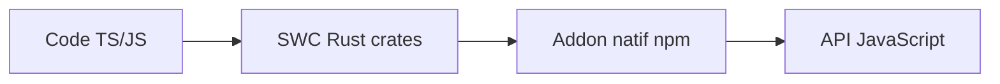

# swc-project/swc

> TypeScript/JavaScript compiler written in Rust, usable from Rust and JavaScript, for web build tools.

## The problem
JS/TS compilers written in JavaScript are slow on large projects.

## What it actually does
Compiles and transforms TypeScript and JavaScript. Provides Rust crates (entry point: the parser) and npm packages with auto-loaded native addons (macOS, Windows MSVC, Linux GNU/musl on x64 and arm64). Rust MSRV 1.73; Node v10+ for use, v20+ for development.

## How it is wired
Diagram not provided for this repository.


## Trying it
```bash
curl https://raw.githubusercontent.com/swc-project/swc/main/scripts/update-all-swc-crates.sh | bash -s
# nécessite jq et cargo upgrade ; le reste est sur le site de documentation
```

## Cost and gotchas
Free. To update the crates, `jq` and `cargo upgrade` are required. The addon cache is set via `SWC_NATIVE_BINDING_CACHE`.

## What it is not
Not a complete bundler on its own. Performance figures point to the website, not verifiable in the README.

## Alternatives
Comparison with Babel deferred to a page on the website (no other repository named).

## For you
Watch: a front-end toolchain building block encountered via other tools, with no direct use in data/AI.
