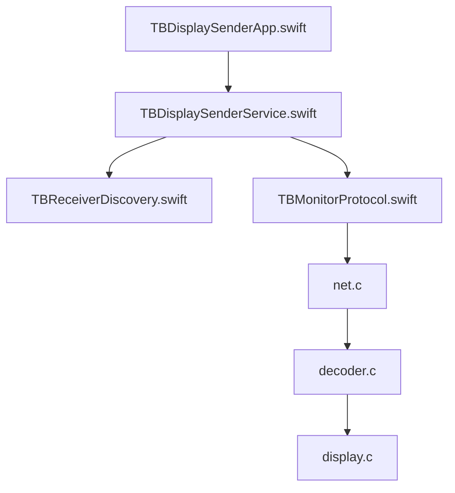

# swellweb/targetBridge

> macOS application that brings back target display mode: one Mac serves as a 5K display for another over Thunderbolt.

## The problem
Apple removed target display mode after the 2014 5K iMac: an old iMac can no longer be used as a display.

## What it actually does
A Swift sender captures the screen and streams it in H.264 or HEVC up to 5K over Thunderbolt Bridge. A C receiver receives, decodes and displays. It offers mirror or extended desktop, multiple receivers, audio, keyboard and mouse relay, text clipboard and brightness. An experimental network transport exists.

## How it is wired
Diagram based on the code diagram.


## Trying it
```bash
xattr -cr ~/Downloads/TargetBridge-arm64.app
xattr -cr ~/Downloads/TargetBridge-Receiver-arm64.app
xattr -cr ~/Downloads/TargetBridge-Receiver-x86_64.app
```

## Cost and gotchas
Free. Sender: Apple Silicon Mac with macOS 14 or later. Receiver: macOS 11 or later. Thunderbolt cable. The applications are not signed. Screen recording and accessibility permissions required.

## What it is not
It is not a Windows or Linux tool. The 5K 60 profile is experimental. The trademark and commercial use are handled separately from the license.

## Alternatives
No alternative named in the README.

## For you
Ignore: a macOS display utility, unrelated to your work.
