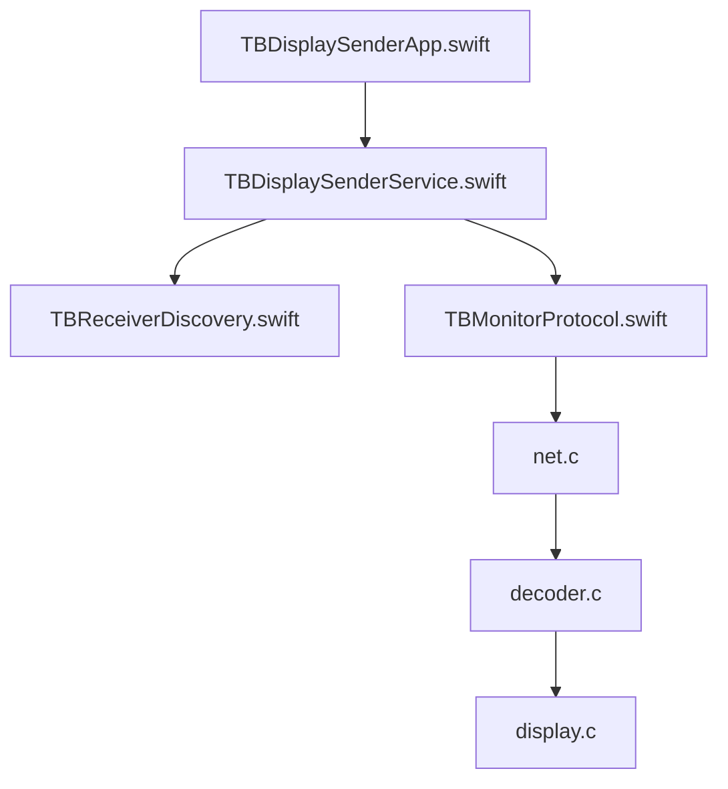

# swellweb/targetBridge

> Application macOS qui rend le mode d'affichage cible : un Mac sert d'écran 5K à un autre via Thunderbolt.

## Le problème
Apple a retiré le mode d'affichage cible après l'iMac 5K de 2014 : un ancien iMac ne peut plus servir d'écran.

## Ce que ça fait vraiment
Un émetteur Swift capture l'écran et le diffuse en H.264 ou HEVC jusqu'en 5K sur Thunderbolt Bridge. Un récepteur en C reçoit, décode et affiche. Il propose miroir ou bureau étendu, plusieurs récepteurs, audio, relais clavier et souris, presse-papiers texte et luminosité. Un transport réseau expérimental existe.

## Comment c'est branché
Schéma d'après le diagramme du code.


## Essayer
```bash
xattr -cr ~/Downloads/TargetBridge-arm64.app
xattr -cr ~/Downloads/TargetBridge-Receiver-arm64.app
xattr -cr ~/Downloads/TargetBridge-Receiver-x86_64.app
```

## Coût et pièges
Gratuit. Émetteur : Mac Apple Silicon avec macOS 14 ou plus. Récepteur : macOS 11 ou plus. Câble Thunderbolt. Les applications ne sont pas signées. Droits d'enregistrement d'écran et d'accessibilité requis.

## Ce que ce n'est pas
Ce n'est pas un outil Windows ou Linux. Le profil 5K 60 est expérimental. La marque et l'usage commercial sont traités à part de la licence.

## Alternatives
Aucune alternative nommée dans le README.

## Pour toi
À ignorer : utilitaire d'affichage macOS, sans lien avec ton métier.

