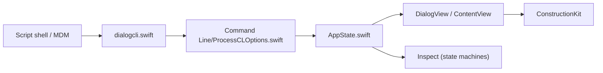

# swiftDialog/swiftDialog

> macOS 15+ utility for administrators: displays custom dialog boxes driven by scripts.

## The problem
macOS administration scripts need to display clean messages, forms and progress indicators, without writing a Swift app.

## What it actually does
A command-line executable (`dialogcli`) parses options and launches a SwiftUI interface: title, Markdown message, icon, buttons, fields, lists, timers. A "Construction Kit" renders declarative forms, and "Inspect" handles deployment and compliance workflows. A notifications utility ships separately.

## How it is wired

## Trying it
The README gives no command: detailed documentation is on swiftdialog.app.

## Cost and gotchas
Free. It requires macOS 15 or later; for macOS 14 and earlier, the README points to v2.5.6. The README is short (external documentation).

## What it is not
It is not a Swift library to integrate: it is a tool driven from the command line, specific to macOS.

## Alternatives
The README cites no alternative.

## For you
Ignore: Mac fleet administration tool, unrelated to data/AI/MLOps work.
