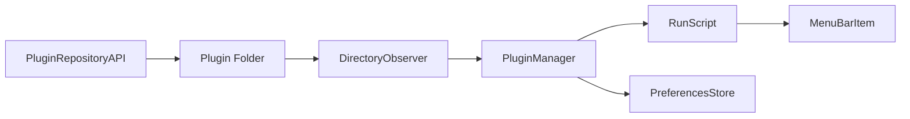

# swiftbar/SwiftBar

> macOS app that shows the output of your scripts in the menu bar.

## The problem
Seeing a piece of information (status, metric) at a glance without opening a window, using a simple script.

## What it actually does
`PluginManager` watches a plugins folder (`DirectoryObserver`), runs each script (`RunScript`) according to the interval in the file name or a cron expression, and parses the output (header, `---`, parameters) into `MenuBarItem`s. Compatible with BitBar/xbar plugins. Types: standard, Shortcuts, ephemeral, streamable.

## How it is wired


## Trying it
```bash
brew install swiftbar
echo "This is Menu Title"
```
(the second example is a minimal plugin, to be saved for instance as `date.1m.sh`).

## Cost and gotchas
Free. Requires macOS 12 or later. Plugins are scripts run with your own permissions: only install trusted ones.

## What it is not
Not a monitoring tool: it displays what the scripts return.

## Alternatives
- xbar/BitBar: same plugin API, whose format SwiftBar adopts.

## For you
Ignore: a Mac desktop gadget; you could use it to follow a training job, but it is not an MLOps tool.
