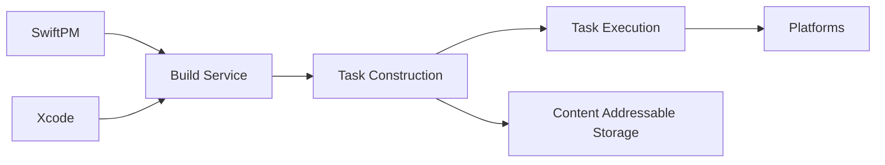

# swiftlang/swift-build

> High-level build system based on llbuild, used by SwiftPM, Xcode and Swift Playground.

## The problem
Building cross-platform Swift projects requires a single build engine shared by Apple and open-source tools.

## What it actually does
A build service with task construction (`SWBTaskConstruction`), execution, a project model, macros, content-addressable storage and support for Apple, Android, Windows, QNX and Unix platforms. It is the default in SwiftPM nightly snapshots; it can be enabled in Swift 6.2 and 6.3 via `--build-system swiftbuild`.

## How it is wired


## Trying it
```bash
swift package --disable-sandbox launch-xcode
swift package --disable-sandbox run-xcodebuild
swift test
docc preview SwiftBuild.docc
```

## Cost and gotchas
Free. Xcode workflows require the latest version of Xcode. Debugging is done by attaching to `SWBBuildServiceBundle`.

## What it is not
Not a tool to install on its own: it serves as the engine behind SwiftPM and Xcode.

## Alternatives
No alternative named in the README.

## For you
Ignore: Swift build tooling, of no interest to a data, AI or MLOps profile.
