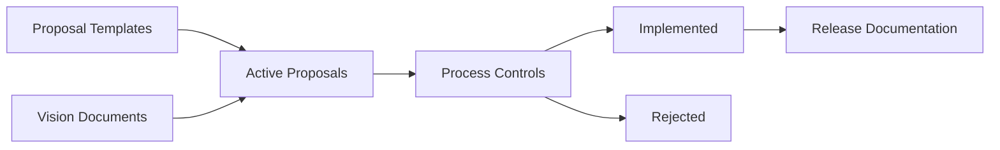

# swiftlang/swift-evolution

> Repository of evolution proposals for the Swift language, its standard library and its package manager.

## The problem
Evolving a language in the open requires a public process of proposals, review and tracking.

## What it actually does
The README is a single sentence. Based on the file tree: numbered proposals in Markdown, templates (Swift, SwiftPM), vision documents (Embedded Swift, macros, testing), release notes and contribution guides.

## How it is wired

## Trying it
No documented command: it is a repository of documents.

## Cost and gotchas
Free. Nothing to install. README under 800 characters: minimal fiche.

## What it is not
Not the Swift compiler or library: only the process and the proposals. The internal organization is inferred from the file tree, not read.

## Alternatives
No alternative named in the README.

## For you
To ignore: useful only if you follow the evolution of the Swift language; unrelated to data or AI.
