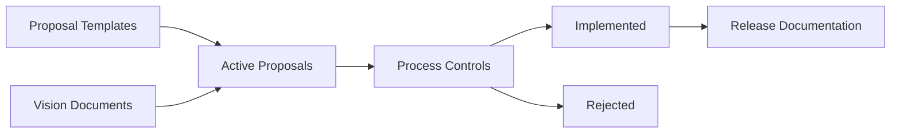

# swiftlang/swift-evolution

> Dépôt des propositions d'évolution du langage Swift, de sa bibliothèque standard et de son gestionnaire de paquets.

## Le problème
Faire évoluer un langage de façon ouverte exige un processus public de propositions, de revue et de suivi.

## Ce que ça fait vraiment
Le README tient en une phrase. D'après l'arborescence : propositions numérotées en Markdown, modèles (Swift, SwiftPM), documents de vision (Embedded Swift, macros, tests), notes de version et guides de contribution.

## Comment c'est branché

## Essayer
Aucune commande documentée : c'est un dépôt de documents.

## Coût et pièges
Gratuit. Rien à installer. README de moins de 800 caractères : fiche minimale.

## Ce que ce n'est pas
Pas le compilateur ni la bibliothèque Swift : seulement le processus et les propositions. L'organisation interne est déduite de l'arborescence, pas lue.

## Alternatives
Aucune alternative nommée dans le README.

## Pour toi
À ignorer : utile seulement si tu suis l'évolution du langage Swift ; sans rapport avec data ou IA.

