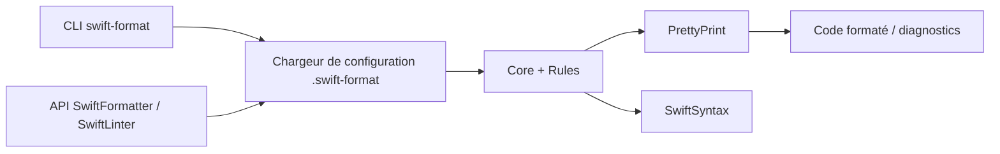

# swiftlang/swift-format

> Swift code formatter and linter, on the command line or as a Swift package dependency.

## The problem
Without a shared formatter, every Swift team argues about style and reviews formatting diffs.

## What it actually does
Three subcommands: `format` (default, with `-i` to write in place without backup), `lint` (`-s` to fail on warnings) and `dump-configuration`. Configuration is a JSON `.swift-format` file searched in the folder and then its parents. It relies on SwiftSyntax and exposes `SwiftFormatter` and `SwiftLinter` to integrate it into other tools. Shipped in the Swift 6 toolchain.

## How it is wired


## Trying it
```bash
brew install swift-format
swift-format lint [OPTIONS...] [FILES...]
swift-format dump-configuration
swift build -c release
swift test --parallel
```

## Cost and gotchas
Free. In-place formatting with `-i` overwrites files without a copy. For older versions (before Swift 5.8), versions must match the toolchain.

## What it is not
The README states that no default Swift style guide is offered: the style applied is only one possibility. It is not a multi-language tool.

## Alternatives
No alternative named in the README.

## For you
Ignore for a data/AI/MLOps profile: it is only useful if you write Swift.
