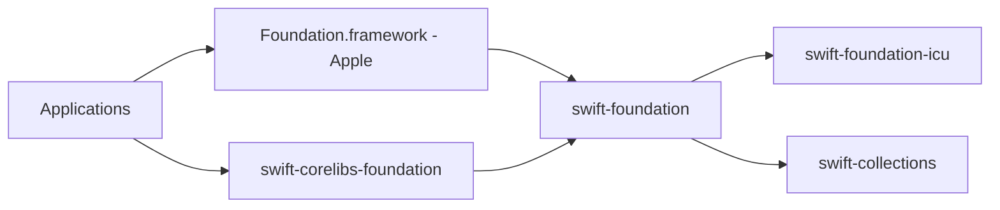

# swiftlang/swift-foundation

> Shared implementation of Foundation's core types in Swift, for teams developing Swift or its platforms.

## The problem
Foundation (URL, Data, Calendar…) existed in different versions depending on the platform, with diverging behaviors.

## What it actually does
`swift-foundation` provides the `FoundationEssentials` and `FoundationInternationalization` modules (URL, Data, JSONDecoder, Locale, Calendar…), used on all platforms. On Apple, the Foundation framework embeds this code; elsewhere it ships with the toolchain and is re-exported by swift-corelibs-foundation. Depends on swift-collections, swift-syntax and an ICU wrapper (swift-foundation-icu). Macros (predicates) are included.

## How it is wired

## Trying it
The README gives no specific command: it points to the "Foundation Build Process" guide and states that a matching nightly Swift toolchain is required. Otherwise, import `FoundationEssentials` or `FoundationInternationalization`.

## Cost and gotchas
Free. The package is intended for developing Foundation itself, not as a dependency of a shipped project: use the copy provided by the toolchain or the OS.

## What it is not
It is not a library to add to your dependencies. It does not replace Objective-C compatibility, which corelibs supports on a "best effort" basis.

## Alternatives
swift-corelibs-foundation (named in the README) for the historical API on non-Apple platforms.

## For you
Ignore: Swift language infrastructure, of no direct interest for a data, AI or MLOps profile.
