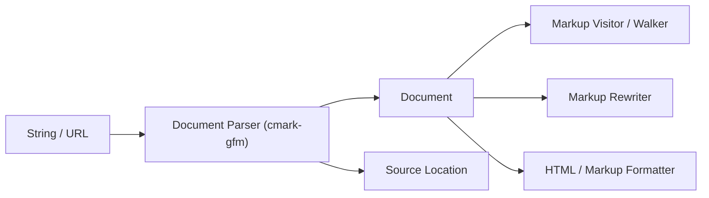

# swiftlang/swift-markdown

> Swift package for parsing, building and transforming Markdown documents, for Swift developers.

## The problem
Manipulating Markdown in Swift without a typed tree forces you to hack together regular expressions.

## What it actually does
The parser is based on cmark-gfm. It produces an immutable tree of value types, with copy-on-write and thread-safe. Visitors, walkers and rewriters traverse or modify the tree; formatters output HTML or Markdown. An extension handles block directives.

## How it is wired


## Trying it
```bash
# Package.swift
# .package(url: "https://github.com/swiftlang/swift-markdown.git", branch: "main"),
# .product(name: "Markdown", package: "swift-markdown")
```
Then in Swift: `let document = Document(parsing: source)`.

## Cost and gotchas
Free. The README references it by the `main` branch, with no pinned version. The dialect may evolve.

## What it is not
Not a full rendering engine. No CLI in the README.

## Alternatives
No alternative named in the README.

## For you
Ignore: Swift library unrelated to your data/AI work.
