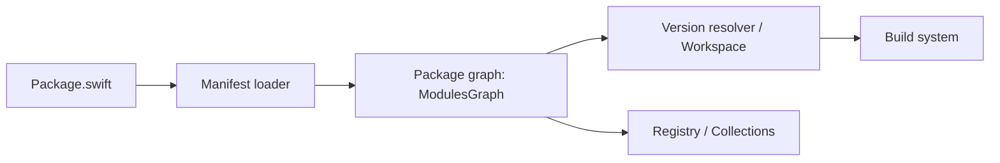

# swiftlang/swift-package-manager

> Swift's package manager and build system: manifest, dependencies, build and tests.

## The problem
Sharing and reusing Swift code, resolving its dependencies and compiling it for macOS and Linux.

## What it actually does
From a manifest, loads the package model, resolves dependencies (Git repositories or registry), builds the package graph, then builds or tests. Also handles collections, registries, signing and fingerprints. Integrated into Xcode since version 11; SourceKit-LSP relies on libSwiftPM. Git required at runtime.

## How it is wired


## Trying it
```sh
swift package --help
swift package --version
```

## Cost and gotchas
Provided in the swift.org toolchains and in Xcode, nothing to buy.

## What it is not
Not a language nor a compiler: it orchestrates the Swift compiler.

## Alternatives
No named alternative.

## For you
Ignore: useful only if you write Swift; unrelated to data/AI.
