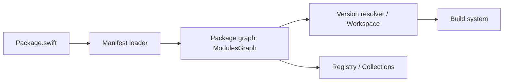

# swiftlang/swift-package-manager

> Gestionnaire de paquets et système de build de Swift : manifeste, dépendances, build et tests.

## Le problème
Partager et réutiliser du code Swift, résoudre ses dépendances et le compiler pour macOS et Linux.

## Ce que ça fait vraiment
À partir d'un manifeste, charge le modèle de paquet, résout les dépendances (dépôts Git ou registre), construit le graphe de paquets puis build ou teste. Gère aussi collections, registres, signature et empreintes. Intégré à Xcode depuis la version 11 ; SourceKit-LSP s'appuie sur libSwiftPM. Git requis à l'exécution.

## Comment c'est branché


## Essayer
```sh
swift package --help
swift package --version
```

## Coût et pièges
Fourni dans les toolchains swift.org et dans Xcode, rien à acheter.

## Ce que ce n'est pas
Pas un langage ni un compilateur : il orchestre le compilateur Swift.

## Alternatives
Aucune alternative nommée.

## Pour toi
Ignorer : utile seulement si tu écris du Swift ; sans lien avec le data/IA.

