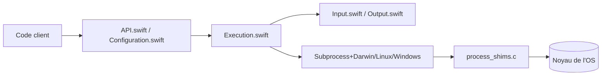

# swiftlang/swift-subprocess

> Cross-platform Swift package for launching subprocesses with Swift concurrency, for Swift developers.

## The problem
Launching a child process in async Swift, with input/output streams, clean cancellation and per-platform options, is laborious with `Process`.

## What it actually does
Exposes `run(...)`: output collection (`.string(limit:)`, `.bytes`) or streaming via a closure (`.sequence`), writing to standard input, configurable environment and working directory, graceful shutdown sequence on cancellation (SIGTERM then SIGKILL). `PlatformOptions` covers Unix, macOS and Windows. The code goes through C shims (`posix_spawn`, `CreateProcess`).

## How it is wired


## Trying it
```bash
swift package --disable-sandbox preview-documentation --target Subprocess
```
Add the dependency in `Package.swift`: `.package(url: "https://github.com/swiftlang/swift-subprocess.git", .upToNextMinor(from: "0.4.0"))`.

## Cost and gotchas
Free. Recent versions (0.5.x, 1.0.x) require Swift 6.2 and Xcode 26. `Execution` values must not escape the closure.

## What it is not
It is not a command-line tool, and there is no version for another language.

## Alternatives
The README names no alternative (it implicitly positions itself against `Process`).

## For you
Ignore: low-level Swift library, useful only if you write Swift.
