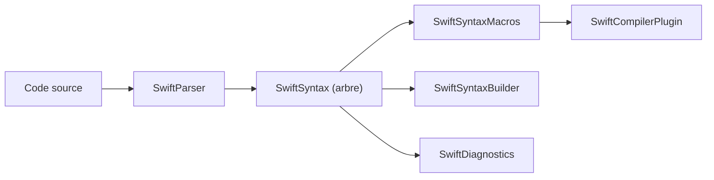

# swiftlang/swift-syntax

> Swift libraries that manipulate the syntax tree of source code, the foundation of the macro system.

## The problem
Parsing, building and transforming Swift code, notably writing macros, requires a syntax tree faithful to the source.

## What it actually does
Provides SwiftSyntax (tree), SwiftParser, SwiftOperators, SwiftDiagnostics, SwiftSyntaxBuilder, SwiftSyntaxMacros, SwiftBasicFormat, SwiftCompilerPlugin, SwiftIDEUtils. Versions follow those of the language (509 for Swift 5.9). Experimental Bazel configuration.

## How it is wired


## Trying it
```swift
dependencies: [
  .package(url: "https://github.com/swiftlang/swift-syntax.git", from: "<#latest swift-syntax tag#>"),
],
```

## Cost and gotchas
Free. The initial build time is long; the `_opt` targets (Bazel) force optimizations. The version number must match the Swift toolchain.

## What it is not
Not a finished formatter or linter: it is a building block for making such tools. Bazel: experimental configuration.

## Alternatives
- swift-ast-explorer.com: to explore the tree interactively.

## For you
Ignore: Swift tooling library, unrelated to data/AI/MLOps work.
