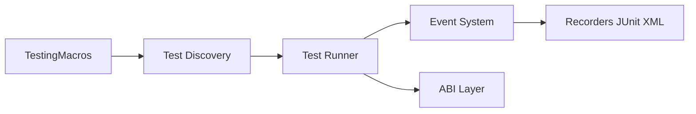

# swiftlang/swift-testing

> Macro-based Swift testing framework (`@Test`, `#expect`), shipped with Swift 6 and Xcode 16.

## The problem
XCTest is verbose and its assertions obscure information about the failure.

## What it actually does
`@Test` declares a test; `#expect` captures the evaluated values to explain the failure; `#require` aborts. Traits (conditions, time limits), tags, suite hierarchy, parameterized tests, parallel execution by default and integration with Swift Concurrency. Coexists with XCTest.

## How it is wired


## Trying it
No install command: the framework is included in the Swift 6 toolchain and Xcode 16.
```swift
@Test func helloWorld() {
  let greeting = "Hello, world!"
  #expect(greeting == "Hello")
}
```

## Cost and gotchas
Free. Building from source requires a recent development toolchain from the main branch.

## What it is not
Not a testing tool for Python or another language. Does not replace XCTest for UI tests.

## Alternatives
The README cites XCTest, alongside which it works.

## For you
Ignore: Swift testing tool, outside your data, AI, MLOps scope.
