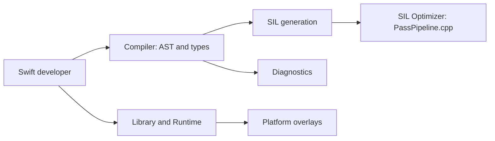

# swiftlang/swift

> The compiler, standard library and runtime of the Swift language, for those who contribute to the language.

## The problem
Writing memory-safe system or Apple applications, without C headers or code duplication.

## What it actually does
The repository contains the compiler: AST and types, storage type checking, diagnostics, SIL representation, SIL optimizer (pass pipeline). It also contains the standard library, the runtime and the per-platform overlays. The README only documents how to build a toolchain and install it in Xcode.

## How it is wired


## Trying it
```bash
./swift/utils/build-toolchain $BUNDLE_PREFIX
# options citées : --dry-run, --test, --distcc, --sccache
```

## Cost and gotchas
Building a toolchain is heavy (C++, swift.org CI); Xcode is required on macOS, and the wrong Xcode version means a build failure (`--clean`, `--reconfigure`).

## What it is not
Not a guide for learning the language (points to swift.org). Not a simple package to install: the README targets compiler contributors. Several subsystems are not detailed in the material provided.

## Alternatives
No alternative named in the README.

## For you
Ignore: this is a language compiler's construction site, outside your data/AI/MLOps stack; only look at it if you need to build a Swift toolchain.
