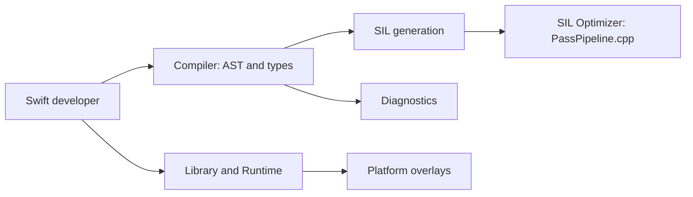

# swiftlang/swift

> Le compilateur, la bibliothèque standard et le runtime du langage Swift, pour qui contribue au langage.

## Le problème
Écrire des applications système ou Apple de façon sûre en mémoire, sans en-têtes C ni duplication de code.

## Ce que ça fait vraiment
Le dépôt contient le compilateur : AST et types, vérification de types du stockage, diagnostics, représentation SIL, optimiseur SIL (pipeline de passes). Il contient aussi la bibliothèque standard, le runtime et les surcouches par plateforme. Le README ne documente que la construction d'une toolchain et de l'installer dans Xcode.

## Comment c'est branché


## Essayer
```bash
./swift/utils/build-toolchain $BUNDLE_PREFIX
# options citées : --dry-run, --test, --distcc, --sccache
```

## Coût et pièges
Construire une toolchain est lourd (C++, CI de swift.org) ; Xcode requis sur macOS, mauvaise version de Xcode = échec de build (`--clean`, `--reconfigure`).

## Ce que ce n'est pas
Pas un guide d'apprentissage du langage (renvoi vers swift.org). Pas un simple paquet à installer : le README vise les contributeurs du compilateur. Plusieurs sous-systèmes ne sont pas détaillés dans la matière fournie.

## Alternatives
Aucune alternative nommée dans le README.

## Pour toi
Ignorer : c'est le chantier du compilateur d'un langage hors de ta pile data/IA/MLOps ; ne le regarder que si tu dois construire une toolchain Swift.

