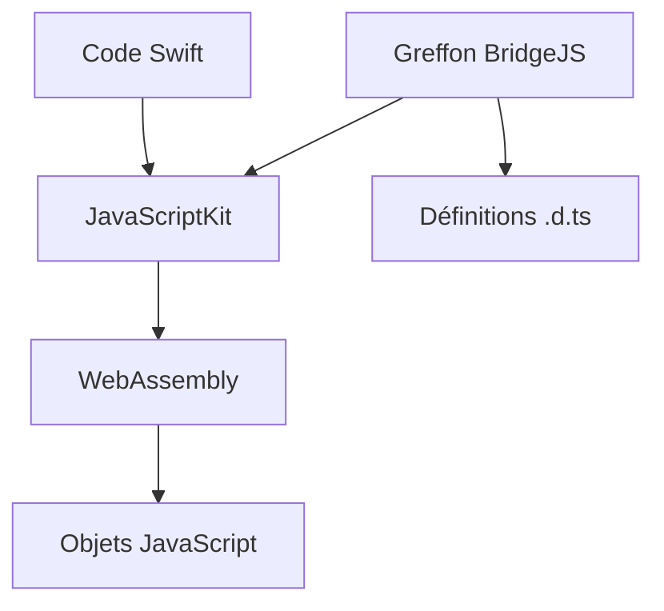

# swiftwasm/JavaScriptKit

> Swift framework for calling JavaScript from code compiled to WebAssembly.

## The problem
Swift compiled to WebAssembly cannot touch the DOM or JavaScript APIs without a bridge.

## What it actually does
Access to JavaScript objects and functions, Swift closures callable from JS, type conversion, promises via `async/await`, multithreading. The BridgeJS plugin, experimental, exports Swift with `@JS` while generating TypeScript definitions, and imports JavaScript through macros or from a `bridge-js.d.ts` file.

## How it is wired

Simplified diagram based on the sheet, no diagram provided.

## Trying it
```bash
# Aucune commande shell dans le README ; voir le tutoriel Hello World.
```

## Cost and gotchas
Free. Requires a Swift-to-WebAssembly toolchain. BridgeJS is experimental and its API may change.

## What it is not
Not a complete web framework: only the interoperability layer.

## Alternatives
No alternative named in the README.

## For you
Ignore: only relevant to Swift-to-WebAssembly.
