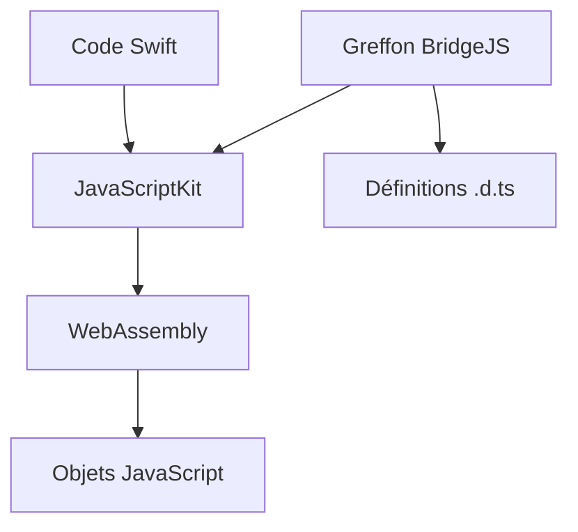

# swiftwasm/JavaScriptKit

> Framework Swift pour appeler JavaScript depuis du code compilé en WebAssembly.

## Le problème
Du Swift compilé en WebAssembly ne peut pas toucher le DOM ni les API JavaScript sans pont.

## Ce que ça fait vraiment
Accès aux objets et fonctions JavaScript, fermetures Swift appelables depuis JS, conversion des types, promesses via `async/await`, multithreading. Le greffon BridgeJS, expérimental, exporte du Swift avec `@JS` en générant les définitions TypeScript, et importe du JavaScript par macros ou depuis un fichier `bridge-js.d.ts`.

## Comment c'est branché

Schéma simplifié d'après la fiche, sans diagramme fourni.

## Essayer
```bash
# Aucune commande shell dans le README ; voir le tutoriel Hello World.
```

## Coût et pièges
Gratuit. Il faut une chaîne Swift vers WebAssembly. BridgeJS est expérimental et son API peut changer.

## Ce que ce n'est pas
Pas un framework web complet : seulement la couche d'interopérabilité.

## Alternatives
Aucune alternative nommée dans le README.

## Pour toi
Ignorer : concerne seulement le Swift vers WebAssembly.

