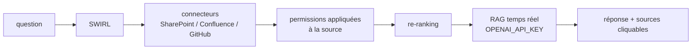

# swirlai/swirl-search

> Federated search and RAG over your applications, with no vector database and no copy of the data.

## The problem
Most "AI searches" require copying everything into a vector database, then governing
that copy forever: ETL, duplication, a second perimeter to secure and audit.
The copy's permissions drift away from those of the source.

## What it actually does
Queries the sources live with the user's permissions, re-ranks the results,
and optionally generates a cited answer with the LLM of your choice.
No vector database, no ETL pipeline, no second copy to govern.
Ships ready to search Arxiv, Europe PMC and Google News; connectors are extensible through
Connector objects. Use cases cited: SharePoint/Confluence/Drive knowledge base, support assistants,
developer assistants on GitHub, Jira and documentation.

## How it is wired


## Trying it
```bash
curl https://raw.githubusercontent.com/swirlai/swirl-search/main/docker-compose.yaml -o docker-compose.yaml
export OPENAI_API_KEY='<your-OpenAI-API-key>'
docker-compose pull && docker-compose up
```

## Cost and gotchas
This repository is SWIRL Community, Apache-2.0, self-hostable. SWIRL Enterprise adds a
three-pass reranker, canonical answers, an MCP server for agents and paid support.
The Docker version keeps neither data nor configuration when stopped: a persistent installation is separate.
Default credentials `admin` / `password` must be changed. OpenAI key at your expense for RAG.

## What it is not
It is not a knowledge base: nothing is stored, so nothing is available offline.
It is not the full version: the MCP server and the advanced reranker are on the Enterprise side.
Latency depends on the APIs queried, not on a local index.

## Alternatives
SWIRL Enterprise, for the three-pass reranker and the MCP server.

## For you
The "no copy of the data" angle is the right argument in a constrained context: keep it in mind.
