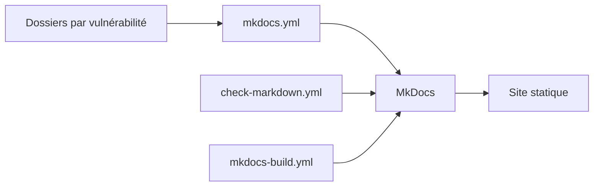

# swisskyrepo/PayloadsAllTheThings

> Reference collection, by vulnerability type, for web penetration testers.

## The problem
Pentesters and security researchers waste time tracking down scattered techniques. This repository organizes them by vulnerability category.

## What it actually does
- One folder per vulnerability type (API key leaks, SQL injection, XSS...).
- Each folder: a description README, file sets for Burp Intruder, images, supporting files.
- A `_template_vuln` template to add a chapter.
- The content is published as a static site by MkDocs and validated by GitHub Actions.

## How it is wired

## Trying it
No command documented: the repository is browsed read-only, or through the alternative web version cited in the README.

## Cost and gotchas
Free. The content is dual-use: to be used only on systems you have written authorization to security-test.

## What it is not
Not executable software nor a scanner: it is documentation. It does not replace a testing methodology or a legal framework.

## Alternatives
- InternalAllTheThings: Active Directory and internal pentest.
- HardwareAllTheThings: hardware and IoT pentest.

## For you
Watch: useful if you secure APIs or model services, but it is an offensive-security reference, not a tool for your daily data / MLOps work.
