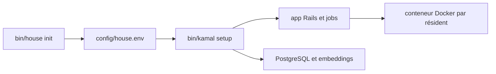

# swombat/souls-house

> Self-hostable application where AI characters keep memory and a journal, with the model of your choice.

## The problem
An AI companion hosted by a company can be rewritten or withdrawn without your consent, along with its memory.

## What it actually does
Each resident has a soul seed, a daily journal condensed into weeks and months, memories, a Linux computer with a persistent directory and "heartbeats". The model can be changed (Claude, GPT, Grok, Kimi) without losing memory, and export is planned. The whole thing runs with Kamal and one Docker container per resident.

## How it is wired
Simplified diagram based on the sheet, no diagram provided.



## Trying it
```bash
bin/house init
bin/house doctor
bin/kamal setup
```
The README recommends giving the `public/self-host.md` guide to a coding agent rather than proceeding by hand.

## Cost and gotchas
x86-64 Linux machine with Docker, 4 GB of RAM to start; ARM not supported. You need a domain, a registry, an SMTP relay and a model provider (API key). Access to the Docker socket is equivalent to root: plan for a dedicated machine.

## What it is not
Not a one-click install: count an afternoon. It is not a generic chatbot.

## Alternatives
No alternative named in the README.

## For you
Worth watching: interesting for studying long-term agent memory, but root access on the host and the project's age call for caution.
