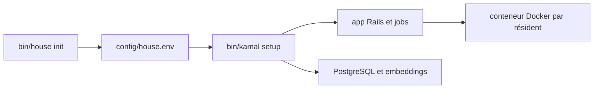

# swombat/souls-house

> Application auto-hébergeable où des personnages IA gardent mémoire et journal, avec le modèle de ton choix.

## Le problème
Un compagnon IA hébergé par une entreprise peut être réécrit ou retiré sans ton accord, avec sa mémoire.

## Ce que ça fait vraiment
Chaque résident a une graine d'âme, un journal quotidien condensé en semaines et mois, des mémoires, un ordinateur Linux avec répertoire persistant et des « heartbeats ». Le modèle se change (Claude, GPT, Grok, Kimi) sans perdre la mémoire, et l'export est prévu. L'ensemble tourne avec Kamal et un conteneur Docker par résident.

## Comment c'est branché
Schéma simplifié d'après la fiche, sans diagramme fourni.



## Essayer
```bash
bin/house init
bin/house doctor
bin/kamal setup
```
Le README recommande de donner le guide `public/self-host.md` à un agent de code plutôt que de procéder à la main.

## Coût et pièges
Machine x86-64 Linux avec Docker, 4 Go de RAM au départ ; ARM non pris en charge. Il faut domaine, registre, relais SMTP et un fournisseur de modèle (clé d'API). L'accès au socket Docker équivaut à root : prévoir une machine dédiée.

## Ce que ce n'est pas
Pas une installation en un clic : compte un après-midi. Ce n'est pas un chatbot générique.

## Alternatives
Aucune alternative nommée dans le README.

## Pour toi
À surveiller : intéressant pour étudier une mémoire d'agent à long terme, mais le droit root sur l'hôte et l'âge du projet imposent la prudence.

