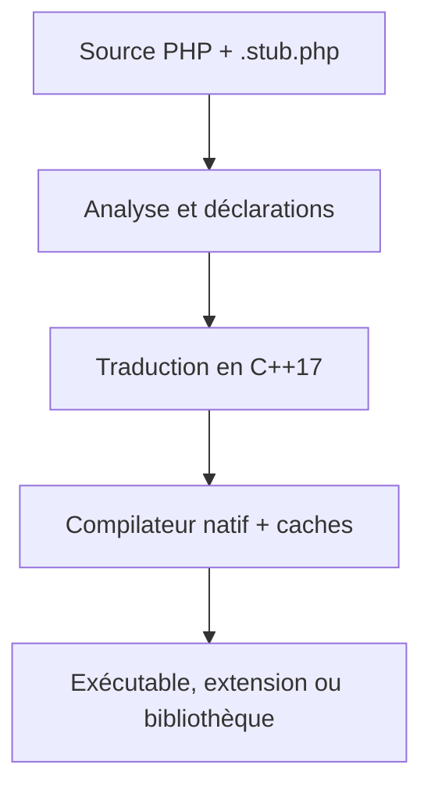

# swoole/typephp

> PHP-to-native-code compiler, written in PHP, producing executables, extensions and libraries.

## The problem
Interpreted PHP is slow at numerical computation and ships its source code in readable form.

## What it actually does
Translates typed PHP into C++17 and then into machine code: native types, typed containers, big numbers (GMP, MPFR), attributes that generate getters and setters, mixing C++ and PHP. Bin, ext and lib modes, a Nano mode without a VM, Linux, Windows, macOS, mobile and WASI targets. It covers only a subset of PHP.

## How it is wired
Simplified diagram based on the sheet, no diagram provided.


## Trying it
```bash
composer require --dev swoole/typephp
vendor/bin/tpc.php project.yml
bin/tpc.php hello.php
./hello
```

## Cost and gotchas
Free. Heavy toolchain: PHP 8.4 to 8.5 with libphp, GCC 9+ or Clang, CMake 3.24+, Composer, GMP, MPFR. Read the list of incompatible PHP functions before adopting.

## What it is not
Not a drop-in replacement for PHP: not all dynamic code is supported. A young project (created in May 2026).

## Alternatives
OPcache and the PHP 8 JIT, compared in the README.

## For you
Keep an eye on it: relevant if you have heavy computation in PHP; unrelated to ML.
