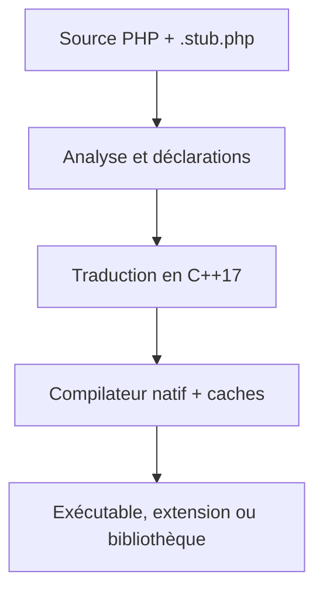

# swoole/typephp

> Compilateur PHP vers code natif, écrit en PHP, produisant exécutables, extensions et bibliothèques.

## Le problème
PHP interprété est lent sur le calcul numérique et livre son code source lisible.

## Ce que ça fait vraiment
Traduit du PHP typé en C++17 puis en code machine : types natifs, conteneurs typés, grands nombres (GMP, MPFR), attributs générant getters et setters, mélange C++ et PHP. Modes bin, ext et lib, mode Nano sans VM, cibles Linux, Windows, macOS, mobile et WASI. Il ne couvre qu'un sous-ensemble de PHP.

## Comment c'est branché
Schéma simplifié d'après la fiche, sans diagramme fourni.


## Essayer
```bash
composer require --dev swoole/typephp
vendor/bin/tpc.php project.yml
bin/tpc.php hello.php
./hello
```

## Coût et pièges
Gratuit. Chaîne d'outils lourde : PHP 8.4 à 8.5 avec libphp, GCC 9+ ou Clang, CMake 3.24+, Composer, GMP, MPFR. Lire la liste des fonctions PHP incompatibles avant adoption.

## Ce que ce n'est pas
Pas un remplaçant direct de PHP : le code dynamique n'est pas tout supporté. Projet jeune (créé en mai 2026).

## Alternatives
OPcache et le JIT de PHP 8, comparés dans le README.

## Pour toi
Surveiller : pertinent si tu as du calcul lourd en PHP ; sans rapport avec le ML.

