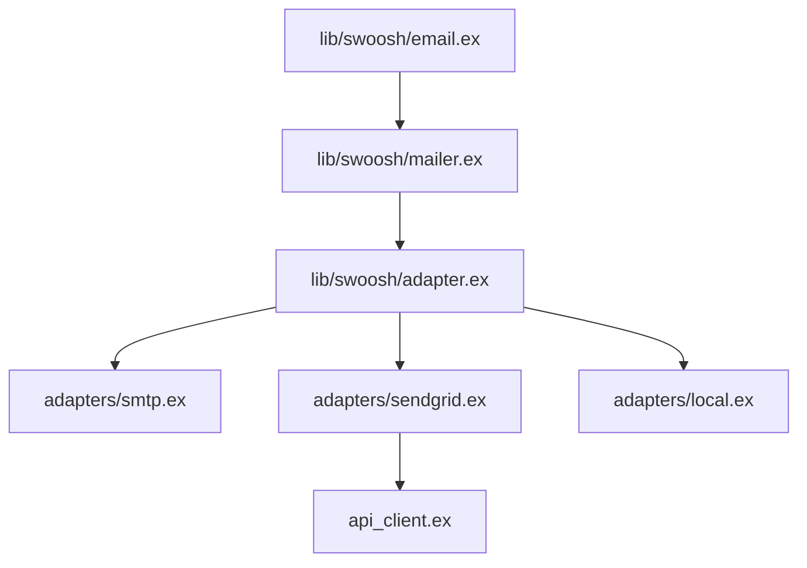

# swoosh/swoosh

> Compose, send and test emails in Elixir, with many provider adapters.

## The problem
Each email provider has its own API; switching provider or testing delivery forces you to rewrite code.

## What it actually does
An email is built with Swoosh.Email, then Swoosh.Mailer delivers it through the configured adapter (SMTP, SendGrid, Mailgun, Postmark, Amazon SES and others). The Local, Test and Sandbox adapters are for development, with an in-browser mailbox preview and telemetry events.

## How it is wired


## Trying it
```bash
git clone https://github.com/swoosh/swoosh.git
cd swoosh
mix deps.get
mix test
```

## Cost and gotchas
Free, but real sending goes through a provider whose service you pay for. Requires Elixir 1.16+ and Erlang OTP 26+. Asynchronous sending is not handled: you need a job queue.

## What it is not
Not an email service or a campaign tool: only a sending layer for Elixir applications.

## Alternatives
No alternative named in the README; Oban and Exq are cited there for asynchronous sending.

## For you
Ignore: reserved for Elixir developers; outside your data/AI profile.
