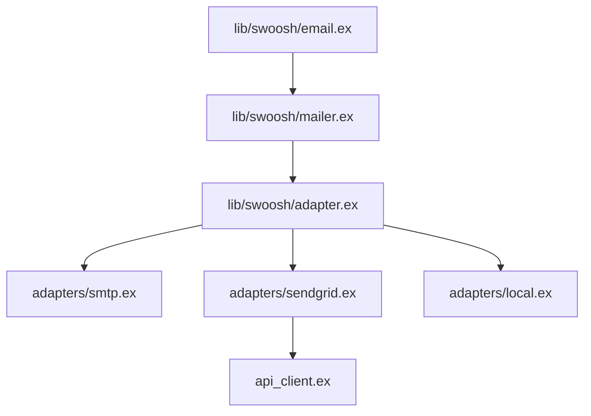

# swoosh/swoosh

> Composer, envoyer et tester des emails en Elixir, avec de nombreux adaptateurs de fournisseurs.

## Le problème
Chaque fournisseur d'email a son API ; changer de fournisseur ou tester l'envoi oblige à réécrire du code.

## Ce que ça fait vraiment
Un email se construit avec Swoosh.Email, puis Swoosh.Mailer le livre via l'adaptateur configuré (SMTP, SendGrid, Mailgun, Postmark, Amazon SES et d'autres). Les adaptateurs Local, Test et Sandbox servent au développement, avec un aperçu de boîte aux lettres dans le navigateur et des événements télémétrie.

## Comment c'est branché


## Essayer
```bash
git clone https://github.com/swoosh/swoosh.git
cd swoosh
mix deps.get
mix test
```

## Coût et pièges
Gratuit, mais l'envoi réel passe par un fournisseur dont tu paies le service. Requiert Elixir 1.16+ et Erlang OTP 26+. L'envoi asynchrone n'est pas géré : il faut une file de jobs.

## Ce que ce n'est pas
Pas un service d'email ni un outil de campagne : uniquement une couche d'envoi pour applications Elixir.

## Alternatives
Aucune alternative nommée dans le README ; Oban et Exq y sont cités pour les envois asynchrones.

## Pour toi
Ignorer : réservé aux développeurs Elixir ; hors de ton profil data/IA.

