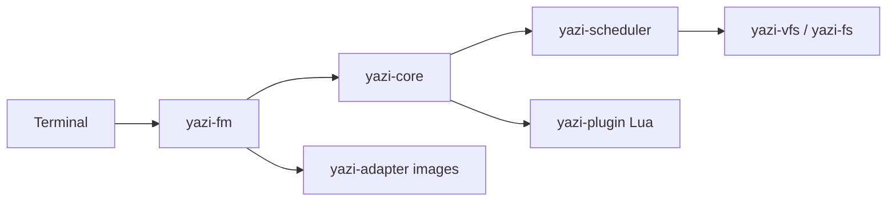

# sxyazi/yazi

> Terminal file manager in asynchronous Rust, with image previews and Lua plugins.

## The problem
Browsing and previewing files (images, PDFs, archives, code) in a terminal is slow or feature-poor.

## What it actually does
TUI application (`yazi-fm`) driving a central state (`yazi-core`) and an asynchronous task scheduler. Local and virtual file systems (SFTP). Lua plugins for previews and interface, message bus between instances, package manager for themes and plugins. Integrations with ripgrep, fd, fzf, zoxide.

## How it is wired

## Trying it
The README contains no installation command: it points to https://yazi-rs.github.io/docs/installation. No invented commands.

## Cost and gotchas
Free. Image preview depends on the terminal (kitty, iTerm2, WezTerm, foot…); otherwise Überzug++ or Chafa is required. "Public beta" status: breaking changes expected.

## What it is not
Not a graphical file explorer. Not stable in the strict sense, given the announced breaking changes.

## Alternatives
No alternative named in the README.

## For you
Watch: real comfort for browsing datasets and outputs on a server, but a convenience tool with no impact on your data/AI work.
