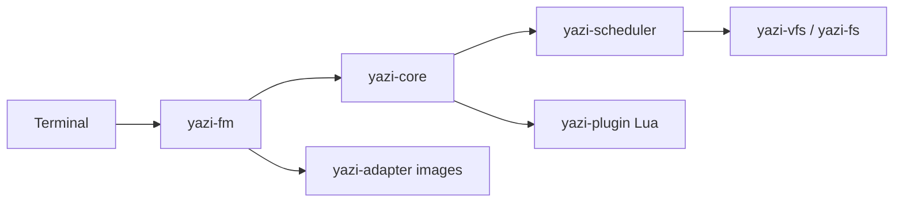

# sxyazi/yazi

> Gestionnaire de fichiers en terminal, en Rust asynchrone, avec aperçus d'images et plugins Lua.

## Le problème
Naviguer et prévisualiser des fichiers (images, PDF, archives, code) dans un terminal est lent ou pauvre en fonctions.

## Ce que ça fait vraiment
Application TUI (`yazi-fm`) pilotant un état central (`yazi-core`) et un ordonnanceur de tâches asynchrones. Système de fichiers local et virtuel (SFTP). Plugins Lua pour aperçus et interface, bus de messages entre instances, gestionnaire de paquets pour thèmes et plugins. Intégrations ripgrep, fd, fzf, zoxide.

## Comment c'est branché

## Essayer
Le README ne contient pas de commande d'installation : il renvoie à https://yazi-rs.github.io/docs/installation. Aucune commande inventée.

## Coût et pièges
Gratuit. Aperçu d'images selon le terminal (kitty, iTerm2, WezTerm, foot…) ; sinon Überzug++ ou Chafa requis. Statut « bêta publique » : changements incompatibles attendus.

## Ce que ce n'est pas
Pas un explorateur graphique. Pas stable au sens strict, vu les ruptures annoncées.

## Alternatives
Aucune alternative nommée dans le README.

## Pour toi
Surveiller : confort réel pour parcourir des jeux de données et des sorties sur serveur, mais outil de confort, pas d'impact sur ton travail data/IA.

