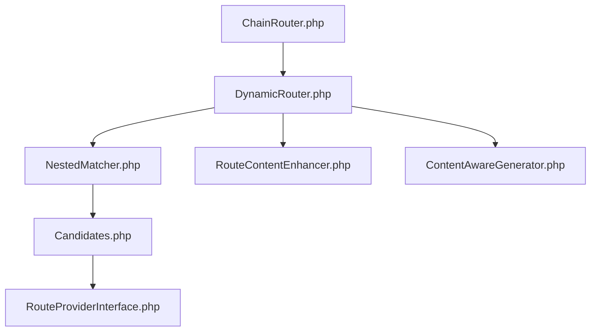

# symfony-cmf/Routing

> PHP component that extends Symfony routing: a chain of routers and routes loaded from a database.

## The problem
The original Symfony routing is static; a CMS needs routes coming from a database.

## What it actually does
`ChainRouter` runs several routers in parallel, including `DynamicRouter`, which loads routes from a provider. `NestedMatcher` looks for candidates and filters them, enhancers add the content to the result, and `ContentAwareGenerator` produces the URLs.

## How it is wired

## Trying it
No documented command: see the `require` section of `composer.json` and the component's documentation.

## Cost and gotchas
PHP and Composer. The README states an MIT license but GitHub does not identify it: to be checked.

## What it is not
Not a full framework: it works without the Symfony stack. The RoutingBundle bundle provides the full integration.

## Alternatives
No alternative named in the README.

## For you
Ignore: PHP CMS component, unrelated to data/AI/MLOps.
