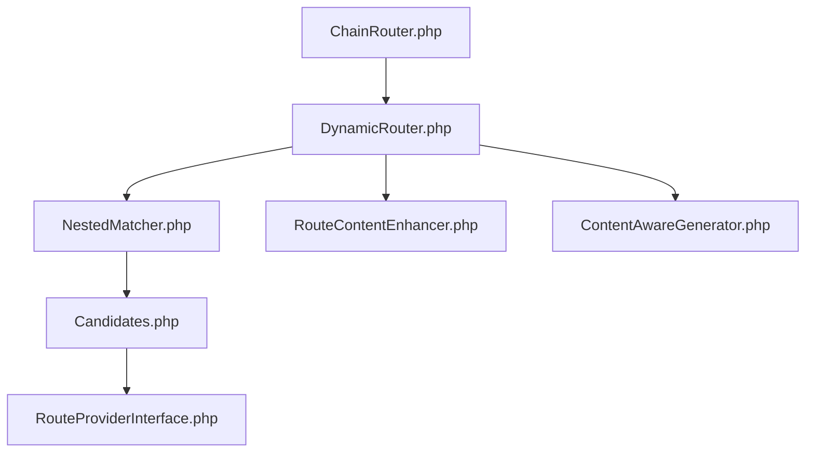

# symfony-cmf/Routing

> Composant PHP qui étend le routage Symfony : chaîne de routeurs et routes chargées depuis une base.

## Le problème
Le routage Symfony d'origine est statique ; un CMS a besoin de routes venant d'une base de données.

## Ce que ça fait vraiment
`ChainRouter` exécute plusieurs routeurs en parallèle, dont `DynamicRouter` qui charge les routes depuis un fournisseur. Le `NestedMatcher` cherche des candidats et les filtre, les enhancers ajoutent le contenu au résultat, `ContentAwareGenerator` produit les URL.

## Comment c'est branché

## Essayer
Aucune commande documentée : voir la section `require` de `composer.json` et la documentation du composant.

## Coût et pièges
PHP et Composer. Le README annonce la licence MIT mais GitHub ne l'identifie pas : à vérifier.

## Ce que ce n'est pas
Pas un framework complet : il fonctionne sans la pile Symfony. Le bundle RoutingBundle sert l'intégration complète.

## Alternatives
Aucune alternative nommée dans le README.

## Pour toi
Ignorer : composant PHP de CMS, sans rapport avec data/IA/MLOps.

