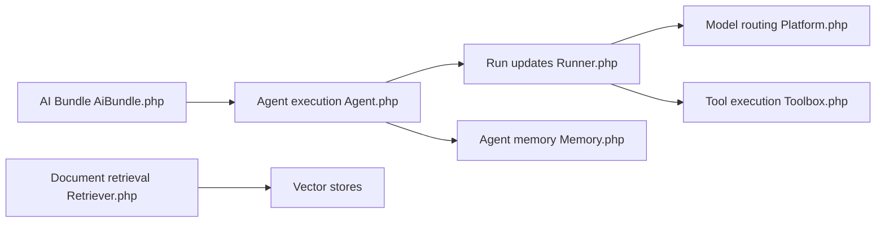

# symfony/ai

> Suite of PHP components to integrate agents, model platforms, memory and MCP into Symfony.

## The problem
Plugging several AI providers, agents and retrieval into a PHP app without rewriting everything per provider.

## What it actually does
Components: Agent (tools, memory, streaming), Chat (history), Platform (OpenAI, Anthropic, Azure, Gemini, VertexAI…), Store (indexing and search), Mate (CLI that lets coding agents inspect a PHP app). AI and MCP bundles for Symfony.

## How it is wired

## Trying it
No command documented in the README: see the examples, the demo application and the documentation.

## Cost and gotchas
API keys for the chosen providers are at your expense. The README is short: the state of each component is not detailed there.

## What it is not
Neither a model nor a service: a set of PHP libraries. It does not replace Python for AI work.

## Alternatives
No alternative named in the README (it cites the PHP MCP SDK via MCP Bundle).

## For you
Keep an eye on it: useful only for a PHP/Symfony team adding AI; without that stack, it brings nothing.
