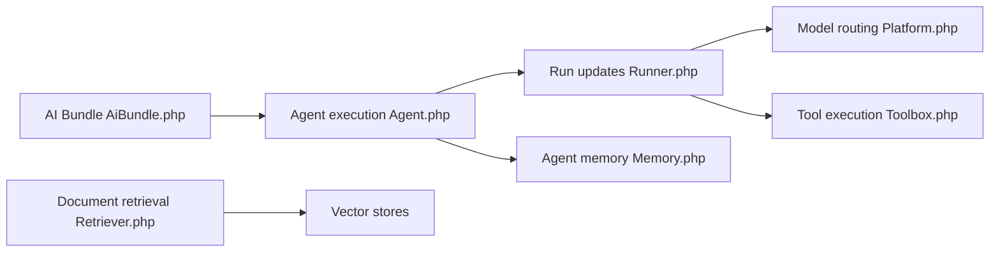

# symfony/ai

> Suite de composants PHP pour intégrer agents, plateformes de modèles, mémoire et MCP dans Symfony.

## Le problème
Brancher plusieurs fournisseurs d'IA, des agents et du retrieval dans une appli PHP sans tout réécrire par fournisseur.

## Ce que ça fait vraiment
Composants : Agent (outils, mémoire, streaming), Chat (historique), Platform (OpenAI, Anthropic, Azure, Gemini, VertexAI…), Store (indexation et recherche), Mate (CLI qui laisse les agents de code inspecter une appli PHP). Bundles AI et MCP pour Symfony.

## Comment c'est branché

## Essayer
Aucune commande documentée dans le README : voir les exemples, l'application de démonstration et la documentation.

## Coût et pièges
Clés d'API des fournisseurs choisis à ta charge. Le README est court : l'état de chaque composant n'y est pas détaillé.

## Ce que ce n'est pas
Ni un modèle ni un service : un jeu de bibliothèques PHP. Il ne remplace pas Python pour le travail d'IA.

## Alternatives
Aucune alternative nommée dans le README (il cite le MCP SDK PHP via MCP Bundle).

## Pour toi
Surveiller : utile seulement pour une équipe PHP/Symfony qui ajoute de l'IA ; sans cette stack, il n'apporte rien.

