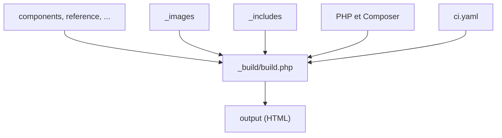

# symfony/symfony-docs

> Source repository of the official documentation of the Symfony PHP framework, for contributors and reviewers.

## The problem
The documentation of a large framework must stay versioned, reviewed and rebuildable by the community.

## What it actually does
The repository contains the reStructuredText files of the guides (components, routing, security, forms, mailer, messenger), the images and the shared includes. A PHP build tool in _build generates the HTML site, which is then served with the built-in PHP server. CI validates contributions. Contributions go to the 6.4 branch, unless the feature is newer.

## How it is wired


## Trying it
```bash
git clone git@github.com:symfony/symfony-docs.git
cd symfony-docs/_build/
composer install
php build.php
php -S localhost:8000 -t output/
```

## Cost and gotchas
Free. PHP and Composer are required; the build tool does not work on Windows (use WSL). A license is present but not identified by GitHub.

## What it is not
It is not the Symfony framework: only its documentation. To read, the online site is enough.

## Alternatives
No alternative named in the README.

## For you
Ignore: only contributing to the Symfony documentation justifies it; to learn the framework, read the official site.
