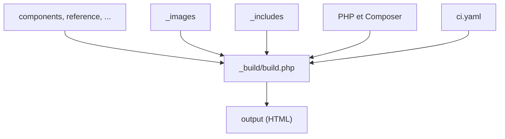

# symfony/symfony-docs

> Dépôt source de la documentation officielle du framework PHP Symfony, pour contributeurs et relecteurs.

## Le problème
La documentation d'un grand framework doit rester versionnée, relue et reconstruisible par la communauté.

## Ce que ça fait vraiment
Le dépôt contient les fichiers reStructuredText des guides (composants, routage, sécurité, formulaires, mailer, messenger), les images et les inclusions partagées. Un outil de build en PHP dans _build génère le site HTML, servi ensuite avec le serveur PHP intégré. La CI valide les contributions. Les contributions vont sur la branche 6.4, sauf nouveauté postérieure.

## Comment c'est branché


## Essayer
```bash
git clone git@github.com:symfony/symfony-docs.git
cd symfony-docs/_build/
composer install
php build.php
php -S localhost:8000 -t output/
```

## Coût et pièges
Gratuit. Il faut PHP et Composer ; l'outil de build ne fonctionne pas sous Windows (passer par WSL). La licence est présente mais non identifiée par GitHub.

## Ce que ce n'est pas
Ce n'est pas le framework Symfony : seulement sa documentation. Pour lire, le site en ligne suffit.

## Alternatives
Aucune alternative nommée dans le README.

## Pour toi
À ignorer : seule une contribution à la documentation de Symfony le justifie ; pour apprendre le framework, lis le site officiel.

