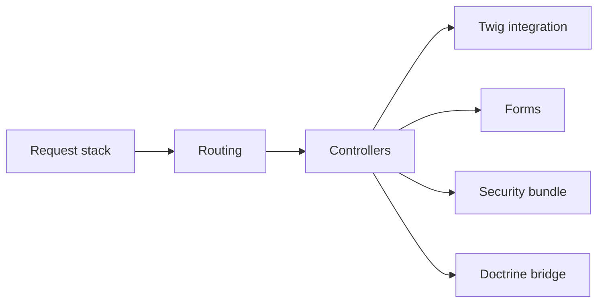

# symfony/symfony

> PHP framework and reusable components for web and console applications.

## The problem
Building a robust PHP application without rewriting routing, forms, security, sessions and console.

## What it actually does
The README details no features; it points to the documentation, the getting-started guide and the demo. From the code: routing, controllers, Twig, forms, security, Doctrine and Monolog bridges, messaging, asset mapper, console, profiler and debug toolbar. Strict semantic versioning, LTS versions and a predictable release process.

## How it is wired

## Trying it
No command in the README: install via Composer, see symfony.com/doc/current/setup.html.

## Cost and gotchas
Free. Symfony 8.2 is looking for financial backers. PHP and Composer are required.

## What it is not
Not a Python framework nor a library to copy here and there: you adopt it as the foundation of a PHP application.

## Alternatives
No alternative cited in the README.

## For you
Ignore: PHP framework, unrelated to data, AI or MLOps work in Python.
