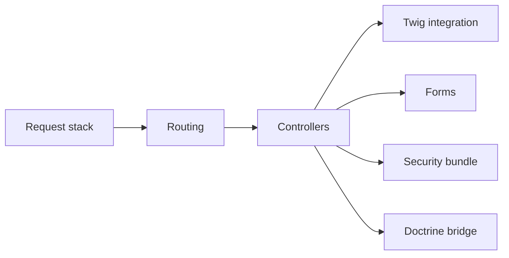

# symfony/symfony

> Framework PHP et composants réutilisables pour applications web et console.

## Le problème
Construire une application PHP robuste sans réécrire routage, formulaires, sécurité, sessions et console.

## Ce que ça fait vraiment
Le README ne détaille aucune fonction ; il renvoie à la documentation, au guide de démarrage et à la démo. D'après le code : routage, contrôleurs, Twig, formulaires, sécurité, ponts Doctrine et Monolog, messagerie, asset mapper, console, profileur et barre de debug. Versionnage sémantique strict, versions LTS et processus de release prévisible.

## Comment c'est branché

## Essayer
Aucune commande dans le README : installation via Composer, voir symfony.com/doc/current/setup.html.

## Coût et pièges
Gratuit. Symfony 8.2 cherche des soutiens financiers. Il faut PHP et Composer.

## Ce que ce n'est pas
Pas un framework Python ni une bibliothèque à copier ici ou là : on l'adopte en tant que socle d'une application PHP.

## Alternatives
Aucune alternative citée dans le README.

## Pour toi
À ignorer : framework PHP, sans lien avec un travail en data, IA ou MLOps en Python.

