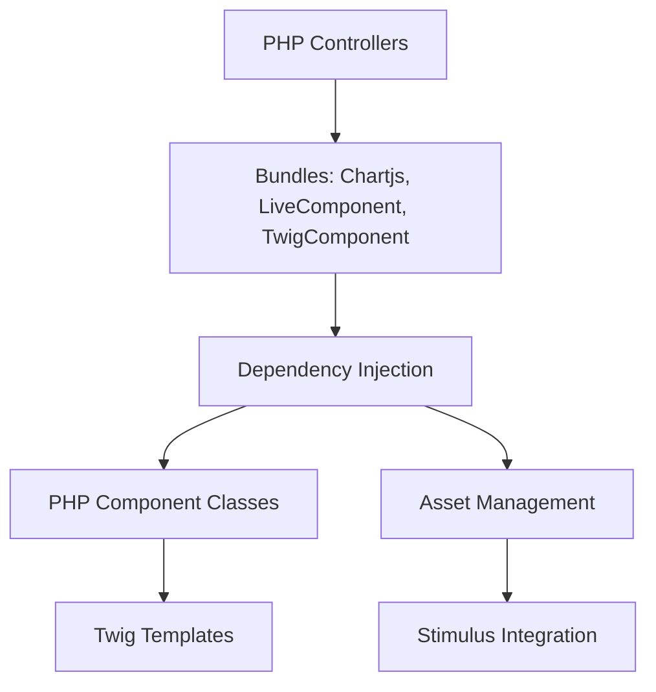

# symfony/ux

> Set of packages linking JavaScript tools to Symfony to build interfaces from PHP.

## The problem
Integrating JavaScript libraries (charts, autocomplete) into a Symfony application forces you to handle front-end configuration by hand.

## What it actually does
Provides packages (Chart.js, Autocomplete, Live Components, Twig Components, Turbo, React, Vue, Svelte...) built on Stimulus, with AssetMapper or Webpack Encore. According to the code, each package has its own Symfony bundle, its dependency injection and its JavaScript assets.

## How it is wired

## Trying it
No command documented in the README: see the Symfony UX installation documentation and the official demo.

## Cost and gotchas
Free. You need a PHP and Symfony project; the shipped JavaScript targets "Baseline Widely available" browsers.

## What it is not
Not a JavaScript framework: it is an integration layer for Symfony only.

## Alternatives
No alternative named in the README.

## For you
Ignore: only useful if you develop in PHP and Symfony, outside a data or AI profile.
