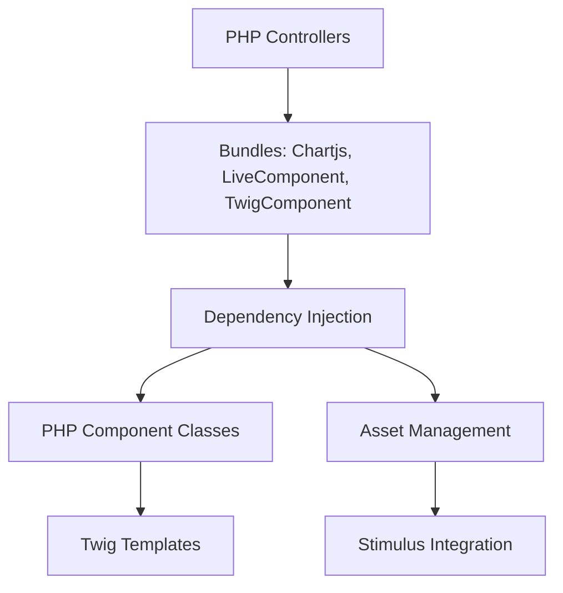

# symfony/ux

> Ensemble de paquets reliant des outils JavaScript à Symfony pour construire des interfaces depuis du PHP.

## Le problème
Intégrer des bibliothèques JavaScript (graphiques, autocomplétion) dans une application Symfony oblige à gérer la configuration front à la main.

## Ce que ça fait vraiment
Fournit des paquets (Chart.js, Autocomplete, Live Components, Twig Components, Turbo, React, Vue, Svelte…) qui s'appuient sur Stimulus, avec AssetMapper ou Webpack Encore. D'après le code, chaque paquet a son bundle Symfony, son injection de dépendances et ses assets JavaScript.

## Comment c'est branché

## Essayer
Aucune commande documentée dans le README : voir la documentation d'installation de Symfony UX et la démo officielle.

## Coût et pièges
Gratuit. Il faut un projet PHP et Symfony ; le JavaScript livré vise les navigateurs « Baseline Widely available ».

## Ce que ce n'est pas
Pas un framework JavaScript : c'est une couche d'intégration pour Symfony uniquement.

## Alternatives
Aucune alternative nommée dans le README.

## Pour toi
À ignorer : utile seulement si tu développes en PHP et Symfony, hors profil data ou IA.

