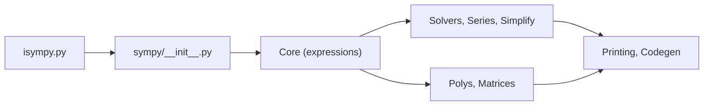

# sympy/sympy

> Python symbolic computation library: algebra, calculus, equations, matrices, code generation.

## The problem
Manipulating exact mathematical expressions (derivatives, series, solving) instead of numerical approximations, or converting them into executable code.

## What it actually does
A `core` kernel defines the expression tree; around it, subpackages: `solvers`, `simplify`, `series`, `polys`, `matrices`, `tensor`, `physics`, `stats`, `ntheory`. Bridges convert: `parsing` (LaTeX, C, Fortran, Mathematica...), `printing` (LaTeX, C, Fortran, Julia...), `lambdify` to NumPy/SciPy. Pure Python; `mpmath` as a dependency, NumPy/SciPy/gmpy optional.

## How it is wired


## Trying it
```bash
pip install sympy
conda install -c anaconda sympy
isympy
```

## Cost and gotchas
Free. The README states the New BSD license, but GitHub does not identify it: check the LICENSE file. Symbolic computation becomes slow on large expressions. 6,011 open issues.

## What it is not
It is not a high-performance numerical engine: for heavy computation, the expression is converted to numerical code. It is not a machine learning tool.

## Alternatives
The README names no alternative; it cites `mpmath` as a component it uses.

## For you
Adopt: useful for checking derivatives of loss functions, or generating numerical code from formulas; weigh the speed for large volumes.
