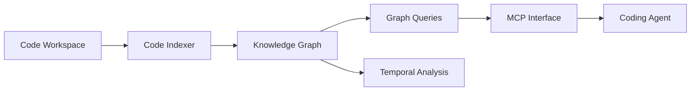

# syncable-dev/memtrace-public

> Local code knowledge graph, queried by agents via MCP, with temporal history.

## The problem
Coding agents re-read files and refactor without seeing dependencies or history.

## What it actually does
Indexes a repository (Rust, Tree-sitter, 16+ languages) into a call graph with no LLM call, exposes more than 25 MCP tools (hybrid search, impact, dead code, temporal evolution, API topology) and 17 skills. Automatic installation for Claude Code, Cursor, Codex, etc. Benchmark figures are the vendor's own. The public repository contains no source code: only the README was seen.

## How it is wired


## Trying it
```bash
npm install -g memtrace
claude mcp add memtrace -- memtrace mcp
MEMTRACE_TELEMETRY=off memtrace start
```

## Cost and gotchas
Private beta: the README asks for a waitlist. Online license validation; opt-out telemetry. 8 GB of RAM minimum.

## What it is not
Not verifiably open source: a distribution repository with no code, unidentified license. Not a conversational memory (Mem0, Graphiti).

## Alternatives
- GitNexus and CodeGrapherContext: AST graphs compared in the README.
- Mem0, Graphiti: conversational memory, slower on code.

## For you
Watch: the idea is good but it is a closed binary in beta with self-reported figures; wait for access and independent tests.
