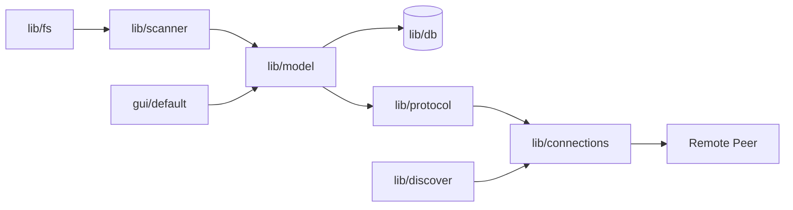

# syncthing/syncthing

> Continuous file synchronization between machines, without a central server.

## The problem
Maintain identical files across multiple machines without entrusting them to a third-party cloud.

## What it actually does
Each machine runs the same instance: it monitors the disk (`lib/fs`, `lib/scanner`), indexes the file status (`lib/model`, `lib/db`), finds peers (`lib/discover`, `lib/beacon`), and communicates via its protocol (`lib/protocol`), either directly or through a relay (`lib/relay`).

Infrastructure services (`stdiscosrv`, `strelaysrv`) provide discovery and relay functionality; a web interface (`gui/default`) configures and monitors the entire system.

The software is signed with GPG and automatically updated with ECDSA signatures. The provided architecture analysis is generic but references the actual directories.

## How it is wired


## Trying it
```bash
go run build.go
```

## Cost and gotchas
Free. Building from source requires Go; otherwise, the published binaries. MPL-2.0 license, copyleft at the file level.

## What it is not
Not a backup: it's synchronization, and a deletion will propagate. Not a public sharing service: the tool is intended for individuals and their devices. The README file directs all the details to external documentation.

## Alternatives
No alternative is specified in the README file.

## For you
Useful for personal use, but irrelevant if you're focusing on data/AI-related information: ignore for monitoring purposes.
