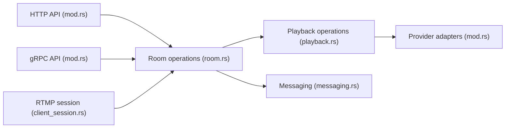

# synctv-org/synctv

> Rust platform for synchronized video watching, with live streaming and media providers.

## The problem
Watching the same video at the same time remotely, with synchronized playback.

## What it actually does
Rooms synchronize playback state in real time. Many media providers (Bilibili, Twitch, YouTube, Alist, Emby/Jellyfin, Nextcloud…), WHIP and RTMP publishing, WHEP playback, HLS and HTTP-FLV, live relay between nodes. HTTP, gRPC and WebSocket surfaces; PostgreSQL storage, optional Redis; Docker Compose and Helm templates.

## How it is wired

## Trying it
No command in the README; see docs.syncs.tv.

## Cost and gotchas
PostgreSQL required, Redis for cluster mode. The README gives neither hardware requirements nor installation examples.

## What it is not
Not an AI or data tool. Third-party providers depend on external services that may change.

## Alternatives
No alternative named in the README.

## For you
Ignore: synchronized-viewing platform unrelated to data, AI or MLOps.
